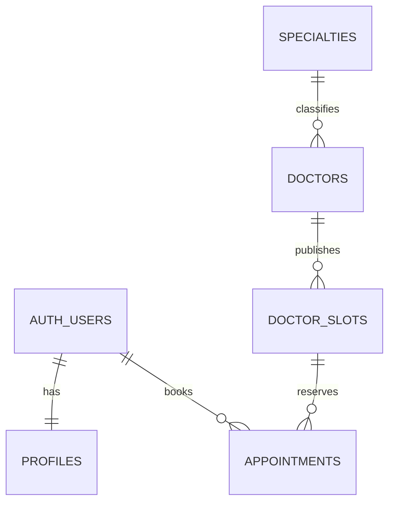

# Supabase Database Architecture

## Scope

The current app is a prototype. Authentication screens only navigate, profile data is held in React context, and doctors, appointment history, availability, and notifications are hard-coded. This initial database supports the first real workflows: patient profiles, public doctor discovery, trusted doctor-slot publishing, and private appointment booking/cancellation.

Supabase Auth remains the source of identity and credentials. `profiles.id` is the same UUID as `auth.users.id`; email and password are not copied into application tables. Patient-owned health and appointment data must never be exposed through public catalog access.

## Entities and Visibility

| Entity | Visibility and purpose |
| --- | --- |
| `profiles` | One-to-one with `auth.users`; authenticated users can read and edit only their own name and phone. The auth trigger creates the row. |
| `specialties` | Public reference catalog used to categorize doctors. Clients can read it; only trusted database administrators can change it. |
| `doctors` | Public provider catalog with specialty, clinic, experience, rating, fee, and booking-enabled flag. Clients can read it; only trusted database administrators can change it. |
| `doctor_slots` | Future, published appointment intervals (`starts_at`/`ends_at`). Public clients can read only open future slots for bookable doctors. Only trusted operators can publish or change slots. |
| `appointments` | Private patient bookings. A patient can read their own bookings and cancel a confirmed booking; clients cannot set another patient, doctor, slot, or completion status. |

Payment instruments, saved addresses, notification records, lab results, prescriptions, and video-call credentials are omitted. Current screens use illustrative values and do not establish persistence or lifecycle requirements for those features. Do not store raw card details in this database. Add those entities only when their real workflows and access requirements are defined.

## Relationships (ERD)

- Deleting an auth user cascades to their profile and appointments. Auth remains the identity authority.
- A specialty cannot be deleted while doctors reference it (`RESTRICT`); retire it from the catalog instead.
- A doctor cannot be deleted while slots reference it (`RESTRICT`); disable booking instead.
- A slot cannot be deleted while any appointment history references it (`RESTRICT`). Cancel an appointment to release its slot.

## Constraints, Indexes, and Time

- `consultation_type` is `in_person` or `video_call`; appointment status is `confirmed`, `completed`, or `cancelled`.
- Ratings are limited to 0–5, counts and fees are non-negative, currency codes are three uppercase characters, slot end must be after its start, and appointment reasons are capped at 2,000 characters.
- A GiST exclusion constraint prevents overlapping slots for the same doctor using explicit start/end instants. A partial unique index allows at most one `confirmed` appointment per slot while retaining cancelled/completed history.
- Required indexes in the migration are `specialties_slug_key` and `specialties_name_key` (unique catalog identifiers), `doctors_specialty_id_idx` (specialty filtering), `doctors_full_name_trgm_idx` and `doctors_clinic_name_trgm_idx` (substring search for doctors and clinics), `doctor_slots_available_start_idx` (open-slot lookup by provider and time), `doctor_slots_no_overlap` (provider interval conflicts), `appointments_one_confirmed_per_slot_idx` (one active reservation per slot), and `appointments_patient_status_created_idx` (patient visit history/status filters). Primary keys and unique constraints also create their supporting indexes.
- All persisted instants use `timestamptz` and are expected to be sent in UTC by clients. Render them in the provider's local timezone in the app; timezone selection is not currently represented in the prototype.
- Mutable tables have `created_at` and `updated_at` timestamps. `updated_at` is database-maintained. Historical appointment timestamps are retained rather than deleted.

## RLS Policy Rationale

RLS is enabled on every application table. Each policy has a narrow purpose:

| Policy | Purpose |
| --- | --- |
| `profiles_select_own` | Lets an authenticated user read only their profile. |
| `profiles_insert_own` | Allows a user to create only their own profile if the auth trigger did not create it. |
| `profiles_update_own` | Restricts profile updates to the authenticated user's row; SQL grants further limit editable columns to name and phone. |
| `specialties_read_public` | Makes the specialty reference catalog available for discovery without sign-in. No client write policy exists. |
| `doctors_read_public` | Makes the provider directory available for discovery without sign-in. No client write policy exists. |
| `doctor_slots_read_open_future` | Exposes only future, open slots belonging to a bookable doctor. No client write policy exists. |
| `appointments_select_own` | Prevents patients from reading anyone else's appointment or reason for visit. |
| `appointments_insert_own_open_slot` | Allows an authenticated patient to create a confirmed booking only for themself and only against an open future slot. |
| `appointments_cancel_own` | Allows a patient to change only their own confirmed appointment to cancelled; SQL grants restrict updates to the `status` column. |

Profile rows are created by a trigger on `auth.users`. Appointment slot triggers reserve/release a slot in the same transaction, and the partial unique index handles simultaneous booking attempts. No client write policy exists for provider catalog or slot management. Trusted administrative operations use secure Supabase management tooling or a server-side credential; never ship the service-role key in the app.

## Seed Data and Operational Notes

The seed migration imports the prototype specialties and six sample doctors. These are demonstration records, not verified medical-provider data. It deliberately creates no patients, bookings, or future availability. A trusted scheduling process must publish real `doctor_slots` before booking is enabled. The app must query these rows rather than treating its local sample times as authoritative.

Slot boundaries are explicit UTC instants; overlap is enforced for each interval without using timezone-dependent timestamp arithmetic inside an index. Completion of appointments is a trusted operation, not a patient action. Database TypeScript types should be generated from the deployed Supabase schema before client integration.

## Migrations

- `supabase/migrations/20261005000100_initial_schema.sql` creates types, tables, constraints, indexes, triggers, grants, and RLS policies.
- `supabase/migrations/20261005000200_seed_provider_catalog.sql` seeds the public specialty and doctor catalog.
